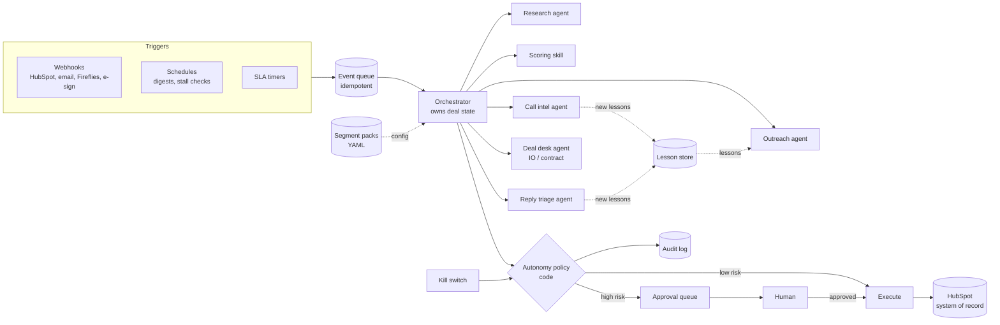
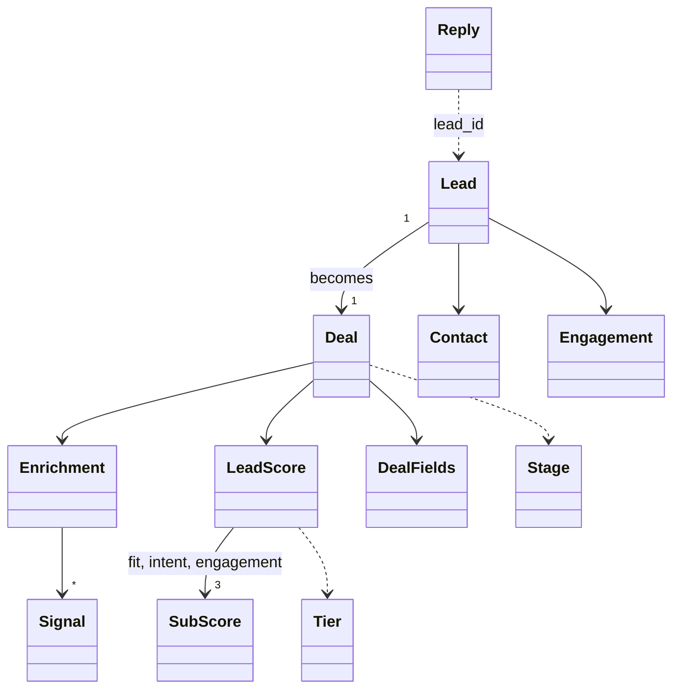

# Agentic Revenue System: Design

> Status: **draft, written alongside the build.** Sections marked *(to be completed)* are filled in when the matching feature lands. Target length: 4 pages max.

## 1. Architecture

Events (webhooks, schedules, SLA timers) enter an idempotent event queue. The **orchestrator** is the only component that owns and changes deal state. It calls single-purpose agents, and every action an agent proposes passes through the **autonomy policy**, which is plain Python, not a prompt. Low-risk actions execute. High-risk actions go to the approval queue for a human. Everything is written to the audit log.

*(Diagram is the target design. Section 2 will mark which parts are built in the vertical slice and which are designed only.)*

## 2. Agents: responsibilities and tools

*(to be completed)*

## 3. Skills and segment packs

**Principle:** skills and agents hold *generic logic*. Segment packs hold *segment knowledge*. Adding a segment means adding `segments/<name>.yaml` and changing no code.

### Segment packs

Each pack (`segments/brand.yaml`) contains:

| Section | Contents | Used by |
| --- | --- | --- |
| `icp_summary`, `products` | Who the ideal customer is, and which Cool AI products fit them | Outreach, proposal / IO |
| `scoring.weights` | Weight of fit / intent / engagement (must add up to 1) | Scoring skill |
| `scoring.tiers` | Minimum total for Tier A and B | Scoring skill |
| `scoring.fit_rules` | Generic rules: `field` + one check (`gte`, `one_of`, `contains_any`) + `points` + `reason` | Scoring skill |
| `scoring.intent_points`, `engagement_points` | Points per buying signal and per interaction | Scoring skill |
| `messaging` | Tone, value props, call to action, **phrases outreach must never use** | Outreach agent |
| `templates` | First-touch subject and body | Outreach agent |

**Fit rules are generic on purpose.** A segment can score on any enrichment field (agencies on `managed_clients`, brands on `locations`) without new code.

**Packs are validated at load time** (`SegmentRegistry`), so a bad pack fails at startup with a clear message and never mid-deal. Checks: weights add up to 1; tier A > tier B; every rule references a real field and has exactly one check; engagement keys exist; the file name matches `segment:`; and segment names can't escape the folder, because the name comes from lead data. YAML is parsed with `safe_load`, so the file can't execute code.

### Core skills

*(to be completed: scoring, templating, IO generation, lesson retrieval)*

## 4. Trigger map

*(to be completed)*

## 5. Data model

All records are typed pydantic models (`revenue_agents/models.py`). Unknown fields and invalid values are rejected at the boundary, so bad data fails fast and never reaches an agent.

| Model | Purpose |
| --- | --- |
| `Lead` | A company and contact as it arrives in the CRM, with engagement counts |
| `Enrichment` | Firmographics and buying signals from an enrichment provider |
| `LeadScore` | `fit`, `intent` and `engagement` sub-scores (0–100), **each with a human-readable reason**, plus the total and the `Tier` (A/B/C) |
| `Deal` | **Deal state owned by the orchestrator:** stage, stage entry time, enrichment, score, deal fields and flags |
| `DealFields` | Commercial facts extracted from calls: budget, products, scope, flight dates, decision-maker, payment and contract terms, next step |
| `Reply` | Inbound email. The body is **untrusted content** and is never treated as instructions |
| `Stage` | `prospect → enriched → scored → outreach → replied → meeting → qualified → proposal → signature → handoff` (or `closed_lost`) |

*Added in later features: `Lesson`, `ApprovalRequest`, `AuditEvent`.*

## 6. Autonomy policy

*(to be completed)*

## 7. Phased rollout

*(to be completed)*

## 8. Trade-offs and limitations

*(to be completed)*
